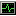

#  terrahour manual

Everything the [README](README.md) leaves out. Press `?` inside the app for the same key
list.

##  Keys

| Key | What it does |
| --- | --- |
| `←` `→` | move through the day, 15 minutes at a time |
| Shift + `←` `→` | one hour at a time |
| PgUp, PgDn | one day at a time |
| `g` | go to a time: `15:30`, `3pm`, `+2h`, `2026-10-05 09:00` |
| `r` | back to now |
| `↑` `↓` or `j` `k` | select a city |
| `K` `J` (or Shift + `↑` `↓`) | move the selected city up or down the list |
| `a` | add a city |
| `d` | remove the selected city |
| `*` | make the selected city your home; the time differences are then measured from it |
| Enter | focus the selected city and dim the others |
| `m` | overlap row on or off |
| `w` | change the working hours |
| `M` | stock exchanges instead of cities |
| `D` | DST radar: the next clock change in every city |
| `A` | alerts |
| `W` | weather off, in °C, in °F |
| `T` | next theme |
| `t` | 12-hour or 24-hour clock |
| `c` | compact layout on, off, or automatic |
| `N` | shade over the night side of the map: off, 25%, 50%, 75%, 100% |
| `L` | map labels show the zone and UTC offset, or the local time |
| `V` | ambient view |
| `+` `-` | zoom the map; `0` resets |
| `[` `]` | zoom the timeline; `0` resets |
| `Z` | mouse wheel zooms, or scrubs time |
| `?` | help; in a small window the list comes in pages, Space turns them |
| `q` | quit |

With the mouse: click a city or its dot on the map to select it, click the bars to jump to
that time, drag the bars to scrub, scroll to zoom, drag the map to pan when zoomed.

In the ambient view: `←` `→` change the featured city, Space goes back to cycling, `m`
drifts the map slowly, `g` makes the map follow a time of day, `V` or Esc leaves.

##  The map follows a time of day

In the ambient view press `g` and type a time, say `09:00`. From then on the map keeps the
place where it is 09:00 right now in the centre, which means it slowly turns west, one full
turn a day. A small tag under the map says "09:00 here". An empty entry switches it off.
From the command line: `terrahour --ambient --follow 09:00`.

##  Command line

```sh
terrahour                                  # your saved cities
terrahour Europe/Berlin "Home=America/Chicago" Naples   # a one-off set of zones or city names, not saved
terrahour --markets                        # start in the exchange view
terrahour --at 2026-10-05T09:00Z           # start frozen at a given time
terrahour --theme nord --12h
terrahour --night-shade 0.5                # shade the night side of the map (0 to 1)
terrahour --ambient                        # straight into the ambient view
terrahour --ambient --follow 09:00         # ...with the map following 9 in the morning
terrahour --compact                        # the small layout, whatever the window size
terrahour --no-mouse                       # leave the mouse to the terminal (text selection)
terrahour --reset                          # forget saved cities and settings
terrahour --version
```

Everything you change in the app is saved to `~/.config/terrahour/config.json`. Zones given
on the command line are for that session only. The map labels can also be set there by hand:
`"labels": "time"` for the local time, `"labels": "zone"` for the zone and UTC offset.

##  Status bars and scripts

```sh
$ terrahour --line
SF 07:30 · NY 10:30 · LON 14:30 · UTC 14:30 · DUB 18:30 · MUM 20:00 · SIN 22:30 · TOK 23:30 · SYD 01:30+1

$ terrahour --watch            # the same line, updating in place (good in a small tmux pane)
$ terrahour --tmux             # with tmux colour codes, for your status-right
$ terrahour --seconds --line   # with seconds
$ terrahour --json --at 2026-03-18T14:30Z | jq '.cities[] | select(.open)'
$ terrahour --once --size 120x40           # one frame of the full screen, then exit
```

The JSON has each city's local time, UTC offset, whether it is inside working hours, minutes
until that changes, and the next clock change.

##  Themes

`T` cycles through them; `--theme name` starts with one. midnight (the default), nord,
dracula, light, gruvbox, gruvbox-light, mono, green, amber, grey, paper, vaporwave,
synthwave, colorblind.

##  Window size

| Your window | What you see |
| --- | --- |
| At least 76 columns wide and 21 rows tall | Everything: the map on top and the city table under it |
| Wide enough, but only 16 to 20 rows tall | The city table on its own, because the map would not fit |
| Narrower than 76 columns, or shorter than 16 rows | The compact layout: one line per city with a small timeline, no map |

On a small map only the selected city is named, so the dots stay readable. `c` forces the
compact layout, or goes back.

##  Other ways to install

You need Python 3.9 or newer and a terminal that supports 24-bit colour, which is almost all
of them. Linux and macOS. On Windows, use WSL to get the full app: installed directly on
Windows, the full-screen view does not start, but the commands that print and exit work
(`--line`, `--json`, `--once`, `--tmux`).

**Ready-made executable, no Python.** Every [release](https://github.com/ACoci86/terrahour/releases)
has one for Linux (x86_64, ARM64) and macOS (Apple Silicon, Intel), with a checksum file next
to it. Download, then:

```sh
chmod +x terrahour-linux-x86_64
./terrahour-linux-x86_64
```

On a Mac the first start is blocked because the file is not signed by Apple. Run
`xattr -d com.apple.quarantine terrahour-macos-arm64` once, or right-click the file and
choose Open.

**Without installing:** `pipx run terrahour` or `uvx terrahour`.

**With uv:** `uv tool install terrahour`, and later `uv tool upgrade terrahour`.

**With pip, in a virtual environment** (recent Debian and Ubuntu refuse `pip install`
outside one):

```sh
python3 -m venv .venv && . .venv/bin/activate
pip install terrahour
terrahour
```

**From a clone.** There is nothing to build:

```sh
git clone https://github.com/ACoci86/terrahour
cd terrahour
python3 -m terrahour
```

If the shell cannot find `terrahour` after a pipx install, run `pipx ensurepath` once and
open a new terminal.

##  Updating

```sh
pipx upgrade terrahour
```

With pip: `pip install --upgrade terrahour` in the same environment. In a clone: `git pull`.
With an executable: download the new one. `terrahour --version` tells you which version you
have.

##  Network

Two features talk to the internet, and both are optional: the online lookup of city names
that are not in the built-in list, and the weather. Set `TERRAHOUR_OFFLINE=1` to switch
both off. Nothing else leaves your machine.
